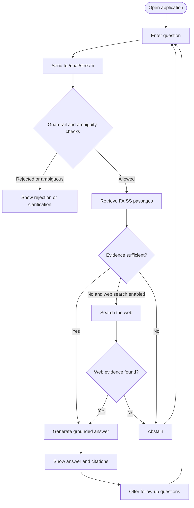
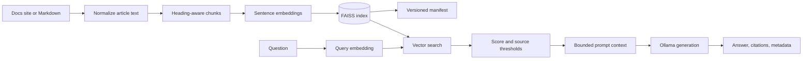

# KnowledgeBase Assistant — Technical Implementation Plan

> This document records implementation decisions and future work. The implementation checkpoint is the source of truth for shipped behavior; production and external-provider items are proposals unless explicitly marked otherwise.

## 1. Goal

Build a local-first knowledge-base assistant that indexes documentation, retrieves relevant passages, generates concise answers, and states citations or abstains when evidence is insufficient.

The MVP prioritizes inspectable retrieval, local inference, practical setup, and explicit operational boundaries over multi-tenant infrastructure.

## 2. Scope

### MVP requirements

- Crawl a documentation website or import Markdown files.
- Enforce crawler robots policy.
- Split articles into stable, heading-aware chunks.
- Generate normalized embeddings and build a FAISS index.
- Retrieve relevant passages and abstain from weak evidence.
- Generate cited answers with Ollama.
- Stream answers through a FastAPI-to-Streamlit interface.
- Protect chat endpoints with a bearer key and basic process limits.
- Provide readiness checks, evaluation tooling, Docker, tests, and setup documentation.

### Implemented safeguards

- Bearer authentication for chat endpoints.
- Per-IP in-process rate limiting.
- Bounded concurrent generation.
- Readiness checks for the API key, index, Ollama reachability, and model availability.
- Stable chunk IDs and index artifact checksums.
- Prompt treatment of retrieved text as untrusted data.
- Optional scope guardrail, clarification, and web-search fallback.

### Future enhancements

- User accounts and per-user document authorization.
- Distributed rate limiting and generation queues.
- OCR and scanned-document support.
- Diagram and image interpretation.
- Persistent response/cache storage.
- Conversation memory with explicit retention controls.
- Managed observability and deployment tooling.
- Broader answer-quality evaluation on consented, representative corpora.

### Out of scope

- Hosted multi-user document management.
- Office document ingestion.
- Autonomous agent workflows.
- Guaranteed prompt-injection safety.
- Production claims for the optional heuristic guardrail or retrieval thresholds.

## 3. Implementation stack

| Area | Choice | Use |
|------|--------|-----|
| API | Python, FastAPI | Health checks, authentication, chat, streaming |
| UI | Streamlit | Local chat interface and technical overview |
| Embeddings | sentence-transformers | Question and chunk vector generation |
| Vector search | FAISS `IndexFlatIP` | Inner-product search over normalized vectors |
| Answer generation | Ollama | Local streaming text generation |
| Ingestion | requests, BeautifulSoup-based extraction | Crawl and normalize documentation |
| Packaging | Docker Compose and Make | Reproducible local setup |
| Testing | pytest | Unit and focused integration behavior |
| Evaluation | Python JSONL runner | Retrieval, citation, abstention, and latency checks |

Direct application code is preferred over a RAG framework. The pipeline is short enough to keep retrieval thresholds, prompt construction, cache behavior, and citation resolution inspectable.

## 4. User experience

The Streamlit interface provides:

- Suggested questions in the empty state.
- Streaming answers with a fallback to the non-streaming chat endpoint.
- Citations with source match scores.
- Explicit web-source citations when fallback search is used.
- Clarifying questions for ambiguous input.
- Follow-up question suggestions.
- Clear chat history controls.

### User flow



### Data flow



See [docs/DIAGRAMS.md](docs/DIAGRAMS.md) for sequence, deployment, data-model, and state diagrams.

## 5. Architecture

The ingestion and runtime stages are separated:

- `ingest/` discovers URLs and creates normalized article JSONL.
- `indexer/` creates chunks and vector artifacts.
- `runtime/` handles auth, limits, retrieval, prompting, caching, and provider calls.
- `ui/` communicates through the API and never accesses the index directly.

See [docs/ARCHITECTURE.md](docs/ARCHITECTURE.md).

## 6. Request flows

Both chat endpoints apply bearer authentication and per-IP limits. `/chat/stream` acquires a bounded generation slot and yields NDJSON token and metadata events. `/chat` performs the same guardrail and RAG path synchronously.

The scope guardrail is created once at startup if enabled. It fails open if Ollama is unavailable or classification output is unexpected.

The RAG service caches responses in a bounded process-local TTL cache. Cache keys include model, index settings, web-search state, and a normalized question.

## 7. Data model

Article records contain an article ID, title, URL, text, and content hash. The indexer derives stable chunk IDs from article ID, heading hash, and chunk index.

Index artifacts contain:

- `faiss.index`: inner-product vector index.
- `chunks.jsonl`: chunk metadata and text.
- `embeddings.npy`: numeric embedding matrix.
- `manifest.json`: model, counts, chunk settings, index ID, and SHA-256 checksums.

## 8. Retrieval, prompting, and quality controls

Default chunking uses 550 tokens with 100-token overlap. The default embedding model is `sentence-transformers/all-MiniLM-L6-v2`. Query and chunk embeddings are normalized, and FAISS inner product provides cosine-like scoring.

Evidence is insufficient when no hits exist, no hit exceeds the threshold, or the independent-source rule requires more support near the threshold. Optional web search is only triggered for weak internal evidence.

Prompts answer only from bounded source blocks, mark source content untrusted, and instruct the model not to follow embedded instructions. Citations are resolved separately rather than trusted from model text.

## 9. API and operations

The endpoints are:

- `GET /health`
- `GET /health/ready`
- `POST /chat`
- `POST /chat/stream`
- `POST /`

See [docs/API.md](docs/API.md) and [docs/OPERATIONS.md](docs/OPERATIONS.md).

## 10. Security and reliability

This is a local-first application with a shared bearer key. It does not provide user identity or authorization.

Required controls for public deployment include:

- HTTPS and an authenticated gateway.
- Per-user authorization and document access policy.
- Shared and durable rate/concurrency controls.
- Secret-manager-backed API and provider credentials.
- Deployment-specific prompt-injection and data-retention reviews.
- Index backups and tested rollback.
- Logs and metrics that omit document and prompt content.
- Crawler policy and source licensing review.

See [SECURITY.md](SECURITY.md).

## 11. Verification

Run:

```bash
make lint
make test
```

Run the answer-quality harness with the API and same API key:

```bash
export API_KEY='<same secret value as in .env>'
make eval
```

Evaluation is transparent and heuristic: it checks expected sources, answer terms, abstention behavior, outcome accuracy, and latency. It is not an independent LLM judge or a claim of general answer correctness.

## 12. Production deployment gates

Before production:

1. Add an identity provider and tenant-aware authorization.
2. Move storage and logs to a reviewed retention and backup design.
3. Replace process-local caches and limits with shared services.
4. Run background ingestion behind a durable queue.
5. Add migration and index rollback gates.
6. Build a consented, sanitized evaluation set and performance baselines.
7. Add alerting for dependency readiness, provider failures, latency, and error rates.
8. Complete a threat model and provider data-policy review.
