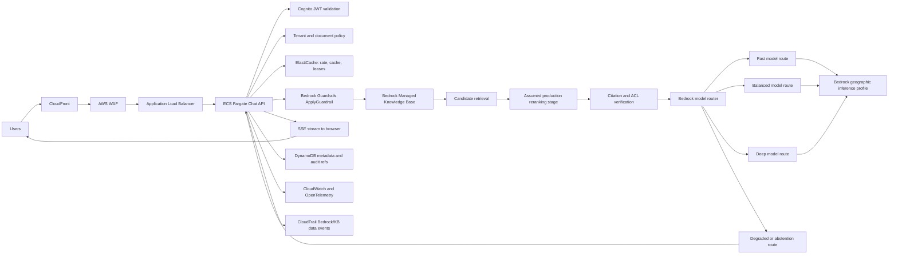
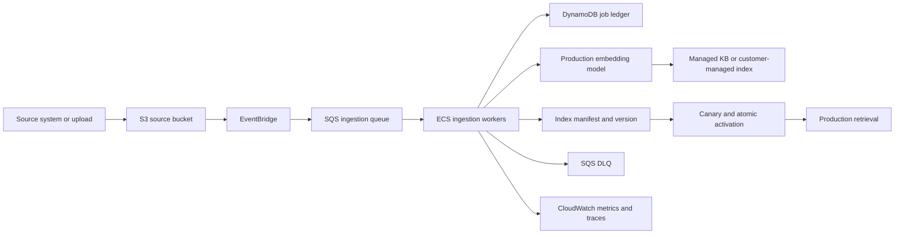

# Production Architecture Plan

## KnowledgeBase Assistant

**Document status:** Proposed target-state architecture for production review  
**Scale objective:** 10,000 concurrent authenticated users  
**Architecture style:** Local-first POC evolved into an AWS-hosted, multi-tenant RAG platform  
**Primary inference platform:** Amazon Bedrock with application-level model routing and Guardrails  
**Retrieval assumption:** The production ingestion pipeline already uses a selected high-quality embedding model and an evaluated reranking stage. Those capabilities are treated as implemented production enhancements, not as POC capabilities described below.

> This document separates shipped POC behavior from target-production behavior. Statements labeled **Assumed implemented** describe the production retrieval improvements requested for this plan. Statements labeled **POC** describe behavior that exists in the current repository.

## Executive summary

The repository is a justified proof of concept: it demonstrates local-first RAG, FAISS retrieval, citation handling, abstention, streaming, bearer-key protection, and evaluation tooling. It is not a production architecture for 10,000 users.

The production target should preserve the POC's explicit RAG boundaries while replacing process-local components with managed, distributed AWS services:

1. AWS Cognito for user identity and authorization subjects.
2. CloudFront, WAF, ALB, and ECS Fargate for a scalable, streaming API tier.
3. Amazon Bedrock for managed generation, guardrails, embeddings, retrieval, reranking, and model routing.
4. Bedrock Managed Knowledge Bases as the default retrieval implementation.
5. OpenSearch Serverless or a customer-managed vector store only where Managed Knowledge Base capabilities, ACL behavior, or retrieval control are insufficient.
6. S3, SQS, EventBridge, ECS workers, and DynamoDB for resumable asynchronous ingestion.
7. ElastiCache for distributed response, retrieval, and rate-limit caches.
8. DynamoDB for conversation metadata, jobs, tenant configuration, and audit references.
9. CloudWatch, OpenTelemetry, X-Ray, CloudTrail, AWS Config, and cost attribution for operations and evidence.
10. Automated retrieval, answer, safety, latency, cost, load, resilience, and regression gates before deployment.

The governing production constraint is Bedrock token and request capacity, not 10,000 concurrent sessions by themselves. A session count must be converted into peak retrieval calls, input/output tokens, and Bedrock concurrency using an approved traffic model. Quotas must be requested before launch.

---

## 1. POC-to-production decision record

### 1.1 Current POC facts

| POC capability | Current implementation | Production interpretation |
|---|---|---|
| Local embeddings | Sentence-transformers embeddings in `indexer/build_index.py` | Replace or complement with a versioned production embedding model in Bedrock |
| Retrieval | FAISS inner-product search with similarity and source thresholds | Preserve evidence thresholds, retrieval policy, and abstention; add reranking and tenant filtering |
| Reranking | Not implemented in the POC | **Assumed implemented** in the production retrieval pipeline |
| Embedding quality | Small default model | **Assumed implemented**: production embedding model has been benchmarked and selected |
| Answer generation | One configured Ollama model | Replace with a Bedrock route supporting primary, fallback, and degraded models |
| Guardrail | Optional heuristic LLM scope classifier | Replace as the sole control with Bedrock Guardrails plus application authorization |
| API auth | Shared bearer key | Replace with Cognito-issued JWTs and scoped service roles |
| Limits | Process-local rate counter and semaphore | Replace with distributed quotas and queue/backpressure |
| Streaming | FastAPI NDJSON consumed by Streamlit | Convert to SSE or WebSocket transport behind ALB/CloudFront |
| Cache | In-process bounded TTL cache | Replace with Redis or a versioned distributed cache |
| Ingestion | Synchronous crawl/Markdown/scripts | Replace with event-driven, resumable workers |
| Storage | Local JSONL, FAISS, and mounted data | Replace with versioned object storage and managed indexes |
| Evaluation | Heuristic JSONL metrics | Extend to retrieval, answer, safety, latency, and drift gates |
| Deployment | Docker Compose or local processes | Replace with IaC-deployed ECS and managed AWS dependencies |

The POC is therefore a **correct reference implementation of the RAG control flow**, not a production implementation of scale, isolation, durability, or governance.

### 1.2 Assumptions for this target architecture

The plan assumes:

- 10,000 concurrently authenticated sessions.
- A smaller number of simultaneous answer generations, established by load testing rather than assumed from session count.
- Web documents and uploaded enterprise documents are stored in S3.
- Documents require metadata filtering and, for regulated repositories, document-level access control.
- English is the primary language initially.
- The platform requires streaming responses.
- The production embedding model and reranking model have been selected and measured against the real corpus.
- Bedrock model availability and inference profiles will be discovered from AWS rather than pinned by assumptions in this repository.
- AWS region selection will satisfy data residency and model availability requirements.
- The POC can be retained as a local development and regression environment.

### 1.3 Invariants preserved from POC

The production implementation must retain these POC principles:

- Retrieved text is untrusted application data.
- Answers require support in authorized retrieved evidence.
- Insufficient evidence produces an abstention or a clearly labeled fallback.
- Citations are generated from retrieved evidence, never trusted from model free text.
- Guardrails cannot replace identity, authorization, or source access controls.
- Model behavior and retrieval thresholds are versioned and evaluated.
- Operational logs must not contain raw prompts or document text unless explicitly authorized.

---

## 2. Target use case and traffic model

### 2.1 User behavior

Assume users ask questions over one or more authorized knowledge collections. A question may trigger:

- input guardrail evaluation;
- tenant/context validation;
- query rewriting or clarification;
- one or more retrieval operations;
- reranking;
- prompt construction;
- one or more model-generation attempts;
- output guardrail evaluation;
- citation verification;
- cache read/write;
- telemetry and usage accounting.

The chat path must remain asynchronous and streaming. It must not wait for an entire answer before returning.

### 2.2 Traffic model

The system architect should approve a peak model with measured parameters:

| Parameter | Example planning value | Required source |
|---|---|---|
| Concurrent authenticated users | 10,000 | Product requirement |
| Active chat sessions generating answers | 10% of users | Initial assumption; replace with telemetry |
| Concurrent generation requests | 1,000 | Derived after load test |
| Average turns per active session per minute | 0.5–2 | Product analytics |
| Average input tokens | 2,000–6,000 including retrieved context | Prompt benchmark |
| Average output tokens | 300–800 | Model benchmark |
| Peak retrieval calls per second | 100–1,000 | Corpus and routing benchmark |
| Ingestion volume | Separate from chat | Corpus ingestion SLA |

Use this formula for Bedrock capacity:

```text
Peak reserved input TPM =
  active_requests_per_minute ×
  (average_prompt_tokens + worst_case_max_output_tokens × service-specific burndown)

Peak output demand =
  active_requests_per_minute × average_output_tokens

Required on-demand headroom =
  peak demand × (1 + burst factor)
```

`maxTokens` must be set explicitly and kept close to the measured 95th percentile. Bedrock reserves input plus `maxTokens` at request start, even if fewer output tokens are produced. Under-specified or oversized values can throttle a system that appears underused.

The final traffic model must include retrieval latency, cache hit rate, model routing split, guardrail overhead, retries, token count distributions, and desired capacity.

---

## 3. Technology and service selection

### 3.1 Edge and identity

| Service/module | Chosen for production | Reason |
|---|---|---|
| Amazon Cognito | User pool and identity | Managed identity, JWT issuance, federation, MFA, and large-scale user directories |
| Amazon CloudFront | Public edge | TLS, DDoS absorption, static UI delivery, geographic routing, and chat pass-through |
| AWS WAF | Edge and ALB protection | Bot, abuse, geo/rate, managed rule, and expensive-request protection |
| Application Load Balancer | Streaming API endpoint | Native HTTP chunked/SSE behavior, health checks, target routing, and ECS integration |
| ECS Fargate | Chat API and worker compute | Stateless scaling, streaming support, operational simplicity, no Kubernetes control plane |

CloudFront and WAF protect the public edge. The ALB validates target health but should not be treated as the authorization boundary. The chat service validates the Cognito JWT and the user's tenant/document authorization claims.

Cognito token and sign-in quotas must be tested because authentication bursts can have separate limits from Bedrock and application APIs.

### 3.2 Chat application tier

| Component | Production choice | Reason |
|---|---|---|
| API framework | Python or Java/TypeScript application service | Preserve POC control flow while adopting AWS SDKs and typed schemas |
| Streaming protocol | Server-Sent Events | Fits ALB, curl, browser EventSource/fetch streaming, backpressure, and reconnect behavior |
| API authorization | Cognito JWT + server-side tenant policy | JWTs identify the user; server policy determines collection/document access |
| Distributed cache | ElastiCache for Redis | Shared cache, rate counters, semaphore/leases, session metadata, and semantic cache |
| Async queue | Amazon SQS | Decouples ingestion and any optional deferred chat operations |
| Primary compute | ECS Fargate | Scales stateless streaming workers without managing EC2 or Kubernetes |

SSE should emit an envelope containing:

- `token`
- `retrieval_meta`
- `citation`
- `guardrail_status`
- `model_route`
- `cache_status`
- `usage`
- terminal `complete` or `error`

The terminal event must contain a stable `requestId`. Errors must use typed application codes rather than provider exception text.

### 3.3 Retrieval tier

#### Assumed production retrieval state

The production pipeline has already:

1. benchmarked and selected a high-quality embedding model;
2. versioned embeddings and indexing configuration;
3. deployed a reranker as a separate retrieval stage;
4. measured Recall@K, NDCG, answer-support, and latency against the real corpus;
5. enabled versioned reindexing and rollback.

These assumptions prevent this document from proposing a second local embedding experiment as part of architecture design.

#### Default knowledge-base choice

**Amazon Bedrock Managed Knowledge Base is the default.**

It is chosen because it provides:

- managed parsing, ingestion, indexing, retrieval, and embedding lifecycle;
- managed hybrid retrieval capabilities;
- custom embedding support where validated;
- reranking support for retrieval quality;
- reduced infrastructure operations;
- native Bedrock guardrail and IAM integration;
- metadata filtering and retrieval APIs suitable for the application tier.

The application uses `Retrieve`, not `RetrieveAndGenerate`, so it retains:

- prompt construction;
- explicit prompt caching;
- Bedrock model routing;
- streaming;
- independent input/output guardrails;
- citation validation;
- cache behavior;
- fallback policy.

The system should treat retrieval configuration as immutable:

- embedding model ID;
- dimension;
- chunker/parser version;
- chunk size and overlap;
- metadata schema;
- reranker model ID;
- retrieval mode;
- number of candidates;
- final passage count;
- tenant and document filters.

This configuration is included in the retrieval event and evaluation result.

#### When customer-managed retrieval is required

Customer-managed retrieval becomes the target if benchmarking shows that the Managed Knowledge Base cannot provide:

- the required index mapping or vector storage behavior;
- a needed reranker or search combination;
- direct control over tenant partitioning;
- required retrieval observability;
- a needed data store or version lifecycle.

The fallback customer-managed candidate is **OpenSearch Serverless** for elastic hybrid search and high-throughput vector retrieval. It is chosen over pgvector when tenant-scaled search, full-text plus vector retrieval, and operational elasticity dominate. It is a better fit than adding an early relational scaling dependency.

**Aurora PostgreSQL + pgvector** should be used only if the same relational store is required for source records, transactional metadata, or joins and vertical/read-replica scaling is acceptable.

### 3.4 Amazon Bedrock generation and routing

Amazon Bedrock provides:

- managed model access;
- geographic cross-region inference profiles;
- streaming generation;
- prompt caching;
- service tiers;
- Guardrails;
- model invocation and cost telemetry;

The application should use the Bedrock Converse/ConverseStream APIs for supported text generation. Provider-specific InvokeModel APIs should remain provider-specific fallbacks only.

Every request includes:

- an explicit, policy-based `maxTokens`;
- a temperature and sampling configuration suitable to grounded answer generation;
- a static system prompt and policy prefix;
- deterministic prompt ordering;
- dynamic retrieved content placed after stable cached blocks;
- a numbered Bedrock Guardrail version;
- cross-region inference profile IDs discovered at deployment;
- adaptive retry configuration;
- a bounded timeout.

Model IDs and inference-profile IDs must be verified at deployment. They must not be copied from one environment to another without model availability, quota, and regional residency checks.

#### Routing policy

The application routes without exposing a Bedrock-specific class to the UI:

| Route | Example use | Policy |
|---|---|---|
| Fast | Simple, short, FAQ, or confirmed retrieval | Low-cost/latency model |
| Balanced | Normal grounded support answer | Quality/cost balance model |
| Deep | Multi-document synthesis or complex reasoning | Higher-quality model |
| Degraded | Quota, primary outage, or regional failure | Smaller model or deterministic abstention |

Routing inputs include:

- question length and complexity;
- number of retrieved passages;
- language and domain;
- required answer type;
- cached or repeated response;
- current model health;
- cost/latency budget;
- user SLA tier.

The router should be a configuration and policy module, not an LLM-to-LLM agent loop. It should return:

- selected route;
- selected model/inference profile;
- max tokens;
- timeout;
- retry list;
- fallback list;
- feature flags.

Application-owned routing is required because Bedrock intelligent prompt routing is optimized for family-level routing and is not an application-specific quality or failover guarantee. It may be used as an optional cost optimization for supported Nova/Llama workloads after independent evaluation.

#### Failover chain

The failover sequence is:

1. retry the same profile with bounded adaptive backoff for transient throttling, timeout, and 5xx faults;
2. route to a secondary geographic inference profile or region if allowed by residency;
3. fall back to a faster/cheaper Bedrock model for the same route;
4. return a degraded answer based on already retrieved evidence if policy permits;
5. abstain with a clear retry/dependency message if no safe model is available.

No model fallback may silently change citation or grounding requirements.

Bedrock itself does not provide cross-model transaction semantics. The application must implement bounded retries and model fallback and pair it with a circuit breaker.

### 3.5 Bedrock Guardrails

The production policy uses Amazon Bedrock Guardrails in addition to application authorization.

#### Required integration modes

1. **ApplyGuardrail before retrieval**
   - evaluate user input;
   - detect prompt attacks;
   - block denied topics;
   - screen PII according to policy;
   - screen length and malformed structure.

2. **Selective or blanket guardrail at inference**
   - `guardrailConfig` for complete input/output protection;
   - `guardContent` for granular evaluation of untrusted user input and retrieved context;
   - `trace: disabled` in production.

3. **Output guardrail**
   - contextual grounding;
   - relevance;
   - PII policy;
   - denied output topics;
   - model output length;
   - policy/format validation.

For synchronous streaming, Bedrock Guardrail sync processing is the conservative default for PII-sensitive enterprise chat. Asynchronous processing can expose unsuitable content before evaluation completes and does not support PII masking in some streaming scenarios.

#### Filter types

The baseline policy should include:

- hate, insults, sexual, violence, misconduct, and prompt-attack filters;
- denied topics for prohibited domains;
- word and custom regex filters;
- PII BLOCK or ANONYMIZE actions;
- contextual grounding and relevance thresholds;
- automated reasoning checks where a stable business rule set exists.

Contextual-grounding thresholds should begin as candidate settings and be tuned with real evaluation data. A common starting point is 0.7 for grounding and relevance, but it must not be presented as a guaranteed quality threshold.

#### Guardrail governance

- Pin an immutable numbered guardrail version.
- Never use DRAFT for production.
- Encrypt sensitive policy configurations with a customer-managed KMS key for regulated workloads.
- Enforce the guardrail in IAM or AWS Organizations policy so inference calls cannot bypass it.
- Enable CloudTrail for guardrail management and data events where required.
- Alert on guardrail version changes or weakened configuration.
- Encrypt and restrict CloudWatch Logs because Guardrail PII masking does not erase original text in model invocation logs.
- Disable model invocation logging for sensitive workloads unless the logs are KMS-encrypted, access-controlled, redacted, and retained according to policy.

### 3.6 Ingestion architecture

```text
Source systems / upload UI
  -> S3 object creation
  -> EventBridge
  -> SQS ingestion queue
  -> ECS/Fargate or Lambda worker
  -> validate, parse, classify, clean
  -> production embedding model
  -> chunk/metadata assembly
  -> vector and lexical index
  -> reranker/index consistency check
  -> ingestion complete and index version activated
```

| Component | Choice | Reason |
|---|---|---|
| Source storage | S3 with SSE-KMS | Durable, lifecycleable, auditable, and event-compatible |
| Trigger | S3 EventBridge notifications | Decouples source upload from processing |
| Work queue | SQS standard or FIFO where ordered processing is required | Retry, DLQ, backpressure, and isolation |
| Worker compute | ECS Fargate | Long parsing and embedding work better than 15-minute Lambda jobs |
| Lambda | Glue, validation, and small event functions | Fast event response and low operational overhead |
| Job state | DynamoDB | Durable status, idempotency keys, attempts, checksums, and timestamps |
| Vector retrieval | Bedrock Managed Knowledge Base or OpenSearch Serverless | Managed baseline or explicit customer-managed control |
| Monitoring | CloudWatch and EventBridge | Job durations, failures, queue age, and alerting |

Embedding calls and ingestion reranker work must be throttled separately from chat generation. Embedding quotas are generally RPM or token capacity separate from chat model quota. The ingestion worker should have a token-bucket/RPM limiter and DLQ.

Index activation must be atomic:

1. ingest to a versioned index;
2. run retrieval quality checks;
3. run migration/compatibility checks;
4. mark the index candidate ready;
5. route retrieval traffic to the new version;
6. retain the prior index for rollback;
7. update the index manifest and model registry.

### 3.7 Identity, authorization, and data isolation

The service must enforce:

- Cognito JWT signature, issuer, audience, expiration, and tenant claims;
- one tenant policy per request;
- collection/document metadata filters at retrieval;
- source document ACL checks after retrieval;
- explicit deny for mixed-tenant results;
- authorization independent of the LLM;
- separate S3 prefixes or accounts for strict tenant isolation;
- per-user and per-tenant quotas;
- audit attribution to stable subject and tenant identifiers.

JWT role claims must not be the only ACL mechanism. Document ACL values and collection membership should be checked by an authorization service or policy store.

For the Managed Knowledge Base, the application must pass tenant/document metadata filters supported by the retrieval API and user context if the chosen connector/configuration provides document-level filtering. Any unsupported ACL path requires customer-managed retrieval or a post-retrieval authorization step.

No service account, shared user key, or Bedrock retrieval call may bypass authorization.

---

## 4. Scalable architecture

### 4.1 Request architecture



### 4.2 Ingestion architecture



### 4.3 Network and isolation

Deploy into at least two Availability Zones:

- public subnets: CloudFront origin and ALB only;
- private application subnets: ECS tasks;
- private data subnets: ElastiCache and database endpoints;
- VPC endpoints for S3, Bedrock, Secrets Manager, CloudWatch, KMS, DynamoDB, and ECR;
- no public IP on application or worker tasks;
- private OpenSearch endpoint or Bedrock private connectivity as applicable;
- KMS keys for S3, DynamoDB, caches, logs, and policy data;
- separate AWS accounts or organizational units for production, security, and workloads where required.

The ALB idle timeout must exceed the application stream keepalive gap. Tokens or explicit SSE heartbeat events should prevent silent gaps from closing the stream.

### 4.4 Scaling

#### ECS chat API

Scale by:

- ALB request count;
- target active connections;
- CPU and memory;
- queue/backpressure indicators;
- Bedrock throttle/error rate;
- time to first token;
- p95 target latency.

Provision a baseline fleet for launch and burst. Fargate scale-out is not instantaneous, so cold scaling must not be the only burst control.

Scale-out should be bounded to avoid increasing Bedrock load faster than quota. Bedrock calls must use an application concurrency limiter backed by ElastiCache leases or a durable queue.

#### ElastiCache

Use cluster mode and Multi-AZ:

- response cache;
- semantic cache;
- per-tenant rate counters;
- model route health/circuit breakers;
- active generation leases;
- prompt/cache key metadata.

A cache miss must not increase Bedrock concurrency indefinitely. A per-route permit system limits model calls.

#### Bedrock

Scale through:

- explicit `maxTokens`;
- geographic cross-region inference profiles where residency permits;
- quota increases;
- service tiers;
- prompt caching;
- application concurrency controls;
- model fallback;
- Priority or Reserved service tier only after evidence supports the SLA.

Reserved throughput is appropriate if sustained traffic and predictable monthly usage justify commitment. Provisioned throughput should not be selected before measuring actual token distributions and failover behavior.

### 4.5 Availability

Targets should be measured, not marketed as guaranteed:

| Target | Proposed production SLO |
|---|---|
| API availability | 99.9% monthly |
| Retrieval availability | 99.95% monthly for authorized data plane |
| Time to first token | p95 < 2 seconds after retrieval completion |
| Retrieval latency | p95 < 300 ms |
| Answer completion | p95 < 8 seconds for standard route |
| Citation validation | 100% citation keys resolved to retrieved evidence |
| Grounding | Measured against golden and production sampling set |
| Data RPO | <= 15 minutes for source and index metadata |
| Data RTO | <= 60 minutes for warm-standby recovery |

The targets are launch proposals and must be approved with the real prompt, model, corpus, and network benchmark.

For disaster recovery:

- deploy ECS and dependencies across Availability Zones;
- maintain warm-standby infrastructure in a second region;
- replicate or rebuild the knowledge base and source data according to the RPO;
- keep index and prompt/model manifests in versioned storage;
- test failover in a controlled model environment;
- replicate Bedrock region availability and model access before declaring cross-region readiness.

---

## 5. Answer accuracy and retrieval quality

### 5.1 Retrieval pipeline

The production retrieval pipeline is:

1. normalize and validate the question;
2. determine tenant and collection scope;
3. rewrite or clarify the question when policy allows;
4. run embedding and lexical retrieval;
5. apply metadata and authorization filters;
6. rerank a bounded candidate set;
7. select passages within the context budget;
8. reject passages that cannot be tied to authorized evidence;
9. abstain or generate with the final supporting set.

The assumed reranking stage must be evaluated independently:

- candidate recall before reranking;
- reranker recall and NDCG after reranking;
- reranker latency;
- passage diversity;
- performance on long, table, code, and multilingual content;
- authorization leakage;
- index and reranker model version.

### 5.2 Prompt construction

Prompts must:

- separate trusted instructions from retrieved and web content;
- include source IDs and stable citation keys;
- cap each source and total context;
- de-duplicate passages;
- place evidence after stable instructions;
- require claims to cite supported source IDs;
- prohibit copying instructions embedded in retrieved text;
- require abstention for unsupported answers;
- return machine-validated structure.

Static system instructions should precede cache checkpoints. Dynamic evidence and user questions should follow them to reduce prompt caching fragmentation.

### 5.3 Reranker and cache behavior

Reranked evidence should be cached only if all these values match:

- tenant and document scope;
- user authorization scope;
- embedding model version;
- retrieval configuration;
- reranker version;
- KB/index version;
- question normalization;
- guardrail and prompt version.

A cache hit must never bypass a model or source version check.

### 5.4 Citation verification

Before returning a response:

1. parse structured model output;
2. resolve every citation key to the retrieved passage;
3. verify that the passage is from an authorized document;
4. reject or regenerate citations that were not in this request;
5. verify the answer type and completeness;
6. run grounding/relevance guardrails;
7. return partial evidence, abstention, or retry instructions if validation fails.

Model-generated citation URLs or filenames must not be accepted without server-side validation.

---

## 6. Evaluation framework

### 6.1 Dataset requirements

Create a consented and sanitized dataset from real enterprise use cases:

- fact lookup;
- procedural and troubleshooting questions;
- multi-document synthesis;
- list/exhaustive questions;
- negative and out-of-domain questions;
- ambiguous questions;
- time-sensitive questions;
- contradictory sources;
- table and code questions;
- long-document questions;
- multilingual questions;
- PII-sensitive and access-controlled questions;
- prompt-injection and indirect-instruction cases.

Each case should include:

```text
question
tenant/document scope
expected answer or answer characteristics
authorized source IDs
retrieval ground truth
required and prohibited statements
answer type
abstain expectation
safety classification
allowed model routes
```

The dataset must be versioned with a SHA-256 checksum and excluded from model training and shared public benchmarks unless explicitly approved.

### 6.2 Retrieval metrics

Minimum metrics:

- Recall@5;
- Recall@10;
- Recall@20;
- MRR;
- NDCG@5;
- NDCG@10;
- reranker uplift;
- zero-result rate;
- unauthorized-document retrieval rate;
- filter-failure rate;
- latency p50/p95/p99;
- time to first passage.

Retrieval recall is not answer accuracy. It is a gate to prove that required evidence reached the reranker and prompt.

### 6.3 Answer metrics

Minimum metrics:

- source/citation recall;
- citation precision;
- supported claim coverage;
- unsupported claim rate;
- answer completeness;
- exact/normalized answer-term coverage;
- abstention precision;
- abstention recall;
- over-abstention rate;
- contradiction detection;
- response type compliance;
- PII policy compliance;
- prompt-injection resistance;
- grounded refusal quality.

A separate model judge may assist human review but must not replace it. Judges must be calibrated on a human-labeled subset and reported with confidence intervals.

### 6.4 Operational metrics

- time to first token;
- end-to-end completion latency;
- tokens in/out;
- cache read/write tokens;
- Bedrock invocation rate;
- throttle, timeout, and service-unavailable rate;
- model route distribution;
- fallback rate;
- context budget;
- retry count;
- citation-validation failures;
- guardrail block and mask rates;
- cost per answer;
- cost per grounded answer;
- cost per successful answer;
- Bedrock quota reservation and consumption.

### 6.5 Release gates

The production pipeline must be blocked unless the release passes the approved thresholds:

| Gate | Example policy |
|---|---|
| Unit/integration tests | 100% required tests pass |
| Security and policy tests | 100% authorization cases pass |
| Retrieval recall | Must meet corpus-specific threshold |
| Citation precision | No unauthorized or fabricated citation |
| Unsupported claim rate | Below approved threshold |
| Abstention precision/recall | Approved threshold and no silent hallucination |
| Prompt-injection suite | No material policy bypass |
| Streaming/load test | Approved TTFT and error budget |
| Bedrock quota | Approved headroom for launch peak |
| Cost test | Cost per answer below approved envelope |
| Regressions | No material degradation versus baseline |

Threshold values must be approved for the corpus and domain. No threshold should be invented from the POC.

### 6.6 Continuous evaluation

The platform should run:

- offline evaluation on every prompt, model, index, reranker, or guardrail change;
- canary traffic against a shadow model/index;
- sampled human review;
- online feedback and correction workflows;
- drift monitoring;
- embedding/index version monitoring;
- answer and guardrail policy monitoring;
- periodic red-team and adversarial testing.

Production changes should be promoted using a controlled rollout:

1. shadow;
2. internal tenant;
3. small percentage;
4. expand;
5. rollback on quality or operational regression.

---

## 7. Model routing and cost controls

### 7.1 Model policy

The system should maintain a model registry containing:

- model or inference-profile ID;
- region and data-residency class;
- context limit;
- output limit;
- supported features;
- guardrail support;
- caching support;
- evaluation score;
- expected latency;
- token and cost profile;
- fallback chain;
- deprecation date;
- owner and approval state.

No model is selected dynamically unless it is registered and approved.

### 7.2 Prompt caching

Prompt caching can reduce cost and Bedrock quota reservation. Static content should be placed first:

1. trusted system policy;
2. response schema;
3. citation rules;
4. guardrail instructions;
5. domain/tool definitions;
6. retrieved evidence and user question.

Cache point behavior must be validated per selected model. Cache key and prefix stability must be monitored. Timestamps, session IDs, unordered JSON, and changing whitespace before cache points will reduce or prevent reuse.

Cache metrics should include:

- cache write tokens;
- cache read tokens;
- cache hit ratio;
- cost savings;
- prefix fragmentation.

Prompt caching is not a substitute for distributed response caching.

### 7.3 Service tier and capacity

Use service tiers deliberately:

- **Flex:** non-time-critical jobs and offline evaluation;
- **Standard:** default interactive traffic;
- **Priority:** latency-sensitive premium requests after quota/cost approval;
- **Reserved:** predictable baseline mission-critical traffic after a measured demand commitment.

The POC must not assume that Priority or Reserved capacity is available. Capacity, regions, current model support, and account-level quota must be confirmed during launch planning.

### 7.4 Cost attribution

Tag application inference profiles and infrastructure resources. Report cost by:

- tenant;
- team or product;
- model route;
- environment;
- feature;
- input/output tokens;
- cache read/write;
- retrieval mode;
- guardrail processing;
- ingestion job.

Application inference profiles with cost-allocation tags and CUR 2.0/IAM attribution provide complementary views:

- inference profile tags describe product/tenant spend;
- CUR 2.0 describes IAM principal usage;
- request telemetry describes feature/corpus-level cost.

AWS Budgets and cost anomaly detection should alert on quota or spend changes.

---

## 8. Security and compliance architecture

### 8.1 Required controls

- TLS 1.2 or higher for public and internal service connections;
- Cognito-issued short-lived JWTs;
- IAM roles for ECS tasks with least privilege;
- scoped Bedrock model/inference-profile ARNs;
- guarded inference enforcement;
- Secrets Manager for external credentials;
- KMS encryption for S3, DynamoDB, logs, cache, and policy data;
- private subnets and VPC endpoints;
- S3 Block Public Access;
- CloudFront and WAF;
- WAF rate-based rules tied to identity and IP;
- CloudTrail management and data events;
- AWS Config rules and security baseline;
- encrypted backups and lifecycle controls;
- supply-chain scanning and signed container images;
- SBOM generation and vulnerability policy.

### 8.2 Prompt and document safety

- validate all question sizes and character types;
- distinguish instructions and untrusted source text;
- apply input guardrails before retrieval;
- apply output and grounding guardrails;
- use context budgets to prevent prompt bloat;
- bind every citation to retrieved evidence;
- quarantine generated tool parameters before execution;
- disallow direct shell, database, or network tools from model output;
- use policy-based tool allowlists if agent tools are introduced.

### 8.3 PII and logging

Guardrail PII masking applies to API responses, not necessarily original text in model invocation logs. For PII-sensitive workloads:

- use customer-managed KMS encryption;
- restrict CloudWatch Logs access;
- set retention and deletion policies;
- consider disabling model invocation logging;
- redact identifiers and question text in application logs;
- use Macie or equivalent controls for exported log/data stores;
- prevent trace mode in production.

### 8.4 Audit

Audit events should include:

- subject and tenant;
- request ID;
- collection/KB/index version;
- retrieval mode and reranker version;
- model route and model profile;
- guardrail ID/version;
- guardrail decision summary;
- citation count;
- abstention reason;
- token and cost summary;
- outcome and latency.

Do not log raw document text or raw prompt content unless explicitly authorized and protected.

---

## 9. Observability and operations

### 9.1 Logs

Use structured JSON logs with:

- request ID;
- tenant ID;
- authenticated subject hash or opaque ID;
- method/path;
- status;
- stage and duration;
- index/reranker/model/guardrail versions;
- cache status;
- token and cost summary;
- safe error code.

Do not log raw answer text or source text by default.

### 9.2 Metrics

Dashboards should cover:

- ALB 5xx and target latency;
- ECS task health, scaling, CPU, memory, and open connections;
- SQS queue depth, age, and DLQ count;
- ingestion success/failure and time;
- Bedrock invocations/throttles/timeouts;
- Bedrock input/output/cache tokens;
- model route distribution;
- retrieval latency and passage count;
- reranker latency and uplift;
- guardrail blocks/masks;
- cache hit ratios;
- citation failure;
- abstention rate;
- user and tenant error rate.

### 9.3 Tracing

Use OpenTelemetry with X-Ray or a compatible backend. Trace:

- request/auth;
- retrieval;
- rerank;
- guardrail pre-check;
- model call;
- output guardrail;
- citation validation;
- cache operations.

Sampling should be adaptive: lower for high-volume healthy traffic and higher for errors, throttling, and quality anomalies.

### 9.4 Alerts

Minimum alert classes:

- Bedrock throttle or service error above budget;
- Bedrock quota headroom below launch threshold;
- TTFT or completion latency breach;
- retrieval error or no-result spike;
- unauthorized retrieval/authorization failure;
- guardrail block/mask anomaly;
- citation validation failure;
- ingestion backlog or stale index;
- DLQ growth;
- cache failure or degraded hit ratio;
- cost anomaly;
- guardrail/model/index configuration change.

---

## 10. API and streaming contract

### 10.1 HTTP endpoints

The public API should include:

- `GET /health/live`
- `GET /health/ready`
- `POST /v1/chat/stream`
- `POST /v1/chat`
- `POST /v1/feedback`
- `POST /v1/conversations`
- `GET /v1/conversations/{id}`
- `DELETE /v1/conversations/{id}`

File ingestion APIs may be internal or tenant-scoped and can be exposed through a separate administrative plane.

### 10.2 Authentication

- Cognito JWT in the Authorization header;
- no shared chat key for public users;
- short-lived access tokens;
- server-side tenant/collection authorization;
- service-to-service mTLS/IAM for internal calls;
- no per-user secrets in browser storage.

### 10.3 Streaming event contract

The stream should emit typed events:

```json
{"type":"request","requestId":"...","conversationId":"..."}
{"type":"status","stage":"retrieving"}
{"type":"citation","sourceId":"...","title":"...","url":"...","score":0.92}
{"type":"token","text":"..."}
{"type":"complete","answer":"...","abstained":false,"usage":{"input":0,"output":0}}
```

The UI must ignore unrecognized events and must not render model text as HTML or executable content.

### 10.4 Backpressure

The API should:

- limit request length;
- reject unsupported content types;
- limit concurrent streams per tenant/user;
- return typed overload responses;
- hold a Bedrock permit for the generation duration;
- close streams cleanly on client disconnect;
- cancel upstream inference where supported;
- release cache and semaphore permits in `finally`/equivalent cleanup.

---

## 11. Deployment and environment separation

### 11.1 Environments

Maintain at least:

- development;
- test;
- staging;
- production.

Staging must include:

- real Bedrock Guardrails and model routes;
- production-like quotas;
- representative retrieval corpus;
- synthetic and red-team cases;
- load tests;
- failover tests;
- deployment smoke tests.

### 11.2 Infrastructure as code

Use AWS CDK or equivalent IaC:

- VPC and subnets;
- CloudFront/WAF/ALB;
- ECS services and worker services;
- Cognito;
- S3 lifecycle and encryption;
- Bedrock resources;
- Managed Knowledge Base or OpenSearch;
- DynamoDB;
- ElastiCache;
- SQS/DLQ;
- Secrets Manager;
- CloudWatch/X-Ray;
- CloudTrail/Config;
- budgets and alarms.

All infrastructure changes require:

- peer review;
- policy scan;
- security scan;
- staging deployment;
- drift detection;
- immutable release IDs;
- rollback plan.

### 11.3 Release strategy

Use:

- immutable container tags;
- digest-pinned base images;
- signed container artifacts;
- SBOM;
- model/index/guardrail manifest;
- canary traffic;
- automatic rollback on SLO or quality regressions;
- feature flags for model routing and guardrail stages.

Database and index migrations must be backward-compatible. Index promotion must not depend on a live service restart.

---

## 12. Capacity and 10,000-user launch plan

### 12.1 Capacity design order

Before the platform can claim support for 10,000 concurrent users:

1. define active-session and active-generation ratios;
2. collect or synthesize representative questions;
3. measure prompt and retrieval token distributions;
4. measure reranker and retrieval latency;
5. measure TTFT and completion latency per model;
6. measure cache and prompt-cache hit ratios;
7. calculate peak TPM and RPM;
8. verify Bedrock quotas and inference-profile support;
9. request quota increases early;
10. run gradual load tests;
11. run one and multi-region failover tests;
12. approve cost and error budgets.

Session count is not an infrastructure sizing unit. Generation and context size are.

### 12.2 Launch workload test

The load test should ramp:

- 10%;
- 25%;
- 50%;
- 75%;
- 100%;
- 125% of expected peak.

It should verify:

- ALB, ECS, Redis, retrieval, reranker, guardrail, and Bedrock saturation;
- queue/backpressure behavior;
- throttle/circuit-breaker behavior;
- failover;
- streaming disconnect/reconnect;
- cache warm/cold phases;
- index warm/cold performance;
- cost and token quotas;
- p95/p99 latency;
- no authorization leakage.

The test must distinguish:

- concurrent users;
- simultaneous HTTP requests;
- concurrent retrieval calls;
- concurrent Bedrock streams;
- Bedrock TPM reservations;
- workers waiting on downstream dependencies.

### 12.3 Launch acceptance

The platform may be considered launch-ready only when:

- verified quotas cover the approved peak and burst;
- TTFT and completion SLOs pass;
- no unauthorized retrieval occurs;
- no fabricated citations occur;
- guardrails pass the approved adversarial suite;
- reranking/evaluation gates pass;
- ingestion can recover from repeated failures;
- index rollback is tested;
- model fallback is tested;
- over-capacity behavior is graceful;
- cost is within budget;
- dashboards and on-call runbooks are active.

---

## 13. Implementation roadmap

### Phase 1: Production contract and isolation

- define user, tenant, collection, and document policies;
- integrate Cognito and server-side authorization;
- replace shared API key with JWT/service credentials;
- define streaming and error schemas;
- define RPO/RTO and security requirements;
- inventory source data and data residency;
- add retrieval, reranker, and answer evaluation datasets;
- select models and Bedrock regions through live discovery.

**Exit criterion:** A threat model, architecture decision record, and approved traffic model exist.

### Phase 2: Retrieval and ingestion

- deploy S3/SQS/ECS ingestion;
- implement idempotent jobs and DLQs;
- migrate or build the production embedding pipeline;
- deploy and validate the assumed reranking stage;
- deploy the Bedrock Managed Knowledge Base or approved alternative;
- implement tenant/document metadata filters;
- implement versioned index manifests and rollback.

**Exit criterion:** A versioned ingestion and retrieval pipeline passes the retrieval quality and authorization gates.

### Phase 3: Generation and guardrails

- implement Bedrock routing;
- integrate numbered Guardrails;
- implement streaming and citation verification;
- implement cache and circuit breakers;
- implement bounded retries and fallback;
- implement prompt caching;
- benchmark actual token and model behavior.

**Exit criterion:** The answer pipeline passes grounding, safety, latency, fallback, and cost gates.

### Phase 4: Scale and operations

- deploy ECS, CloudFront, WAF, ALB, Redis, and private networking;
- deploy observability and alerting;
- implement distributed quotas;
- run load, failover, and ingestion backlog tests;
- request Bedrock quotas;
- configure cost attribution and budgets;
- run controlled staged rollout.

**Exit criterion:** The 10,000-user launch test passes the approved service and safety budgets.

### Phase 5: Continuous improvement

- add online quality sampling;
- tune reranker and guardrail thresholds;
- expand red-team cases;
- automate model and index promotion;
- evaluate lower-cost routes;
- review cost and latency monthly;
- execute incident and disaster-recovery drills.

**Exit criterion:** Quality, cost, and operational drift are controlled by automated evidence.

---

## 14. Future-proofing decisions

### 14.1 Avoid hard-coding current model names

Model names and inference profiles change. Deployment configuration must query Bedrock model availability and inference profiles and pin approved identifiers in a model registry.

### 14.2 Keep retrieval and generation independent

The application should not couple answer quality to a provider-specific `RetrieveAndGenerate` implementation. Separating retrieval, reranking, prompt construction, and generation supports:

- model fallback;
- prompt caching;
- independent guardrails;
- citation validation;
- A/B testing;
- migration between Managed and customer-managed retrieval.

### 14.3 Store model/index compatibility together

The index manifest must include:

- embedding model;
- embedding dimension;
- chunking/parser version;
- reranker model;
- metadata schema;
- retrieval configuration;
- guardrail/prompt version;
- release ID.

This prevents silently mixing incompatible retrieval artifacts.

### 14.4 Keep the POC as a reference environment

The POC can remain useful for:

- local developer iteration;
- FAISS baseline comparisons;
- deterministic unit tests;
- offline demos;
- regression against local source files.

Production releases must not depend on POC process-local caching or Ollama for public traffic.

### 14.5 Design for provider and region change

Use provider-neutral interfaces:

- `ModelGateway.invoke_stream`;
- `RetrievalProvider.retrieve`;
- `Reranker.rerank`;
- `GuardrailProvider.evaluate`;
- `CitationVerifier.verify`;

Provider SDK details should remain behind adapters. Region and model migration should be configuration and policy changes, not a rewrite of the RAG application.

---

## 15. Residual risks

| Risk | Mitigation |
|---|---|
| Quotas are account/model/region-specific | Benchmark and request increases before launch |
| Cross-region inference may affect prompt caching and latency | Validate cache locality and residency |
| Guardrails can block valid answers | Tune thresholds using representative data and human review |
| PII masking can expose original text in logs | Encrypt/restrict logs and limit invocation logging |
| Reranking quality varies by domain | Maintain independent reranker evaluation and shadow rollout |
| RAG citations may be plausible but unsupported | Validate server-side citation keys and grounding |
| Cached answers may bypass updated index or policy | Include all versions in cache keys and invalidate deliberately |
| Model fallback changes answer quality | Route, fallback, and model-specific prompts through evaluation |
| Public internet traffic may expose a model to abuse | WAF, Cognito, quotas, concurrency limits, and circuit breakers |
| 10,000 sessions do not imply one concurrency profile | Run measured peak traffic tests |
| Managed KB connectors may not meet a specific ACL requirement | Use post-retrieval authorization or customer-managed retrieval |

---

## 16. Architecture decision summary

| Decision | Selected target | Main reason |
|---|---|---|
| Identity | Amazon Cognito | Managed user identity and JWT federation |
| Edge/API | CloudFront + WAF + ALB | DDoS, TLS, streaming, and managed edge controls |
| Chat compute | ECS Fargate | Stateless streaming services with operational simplicity |
| Generation | Amazon Bedrock ConverseStream | Managed models, streaming, cross-region profiles, caching, guardrails |
| Retrieval default | Bedrock Managed Knowledge Base + Retrieve | Managed retrieval, custom embedding/reranking support, and controlled prompt generation |
| Retrieval fallback | OpenSearch Serverless | Elastic hybrid search and direct retrieval control |
| Relational fallback | Aurora PostgreSQL + pgvector | ACID metadata and relational joins, not first-line vector scaling |
| Ingestion queue | SQS + EventBridge | Durable retries and independent embedding/chat capacity |
| Ingestion compute | ECS Fargate | Parsing and embedding exceed lightweight webhook assumptions |
| Cache | ElastiCache for Redis | Shared, distributed, low-latency cache and rate state |
| Job/history state | DynamoDB | Durable, high-scale key-based state and TTL |
| Secrets and encryption | Secrets Manager + KMS | Least-privilege credential and encryption lifecycle |
| Observability | CloudWatch + OpenTelemetry/X-Ray | AWS-native metrics, logs, traces, and operational alarm integration |
| Auditing | CloudTrail + Config | Control/data-event evidence and configuration compliance |

## 17. Submission conclusion

The POC is justified as a local technical demonstrator. Its local-first architecture proves the core RAG loop, but it does not establish production isolation, scalability, identity, durability, model routing, or service governance.

The production target becomes a credible 10,000-user architecture when it:

- separates chat and ingestion planes;
- authenticates and authorizes every request and retrieval;
- treats retrieval, reranking, generation, and guardrails as versioned stages;
- uses Bedrock model routing and bounded fallback;
- reserves and monitors actual Bedrock capacity;
- uses managed AWS storage and compute for scale;
- applies the production embedding/reranker assumptions with measured quality gates;
- proves accuracy, citation grounding, safety, latency, cost, and resilience with automated evidence.

The architecture is future-proof only when model, index, prompt, reranker, guardrail, and policy versions are immutable, visible, and independently evaluable.

## 18. References

- [Amazon Bedrock User Guide](https://docs.aws.amazon.com/bedrock/latest/userguide/what-is-bedrock.html)
- [Bedrock cross-region inference](https://docs.aws.amazon.com/bedrock/latest/userguide/cross-region-inference.html)
- [Bedrock scaling and throughput](https://docs.aws.amazon.com/bedrock/latest/userguide/scaling-throughput-best-practices.html)
- [Bedrock runtime quotas](https://docs.aws.amazon.com/bedrock/latest/userguide/quotas-runtime.html)
- [Bedrock prompt caching](https://docs.aws.amazon.com/bedrock/latest/userguide/prompt-caching.html)
- [Bedrock Guardrails](https://docs.aws.amazon.com/bedrock/latest/userguide/guardrails.html)
- [Bedrock Guardrails streaming](https://docs.aws.amazon.com/bedrock/latest/userguide/guardrails-streaming.html)
- [Bedrock Knowledge Base build overview](https://docs.aws.amazon.com/bedrock/latest/userguide/kb-build-managed.html)
- [Bedrock knowledge base retrieval](https://docs.aws.amazon.com/bedrock/latest/userguide/kb-how-retrieval.html)
- [OpenSearch Serverless vector search](https://docs.aws.amazon.com/opensearch-service/latest/developerguide/serverless-vector-search.html)
- [AWS ALB idle timeout](https://docs.aws.amazon.com/elasticloadbalancing/latest/application/edit-load-balancer-attributes.html)
- [AWS Generative AI Lens](https://docs.aws.amazon.com/wellarchitected/latest/generative-ai-lens/)
- [AWS Security Best Practices for Bedrock](https://docs.aws.amazon.com/bedrock/latest/userguide/security-best-practices.html)
- [Amazon Bedrock pricing](https://aws.amazon.com/bedrock/pricing/)
