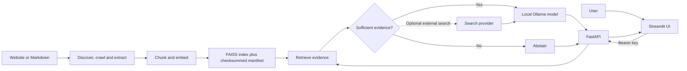

# Interview showcase

KnowledgeBase Assistant is a local-first, end-to-end retrieval-augmented generation application. It demonstrates ingestion, indexing, grounded retrieval, streaming generation, API/UI integration, operational controls, and a repeatable evaluation workflow without presenting a local demo as a hosted multi-tenant service.

## Five-minute demo

### Prepare

1. Follow [INSTALL.md](INSTALL.md) to install dependencies and Ollama.
2. Set a high-entropy `API_KEY` in `.env`, build the sample index with `make sample`, and pull the configured model.
3. Start the API and UI with `make run`; open <http://localhost:8501>.
4. Ask a question answered by the sample corpus, then inspect the citations and follow-up suggestions.
5. Ask a question the sample corpus cannot answer. Show that weak evidence leads to abstention rather than a confident answer from model memory.
6. Visit `/health` and `/health/ready` on the local API to contrast liveness and dependency readiness.
7. Optionally run `make eval` with `API_KEY` exported to produce per-question results and a dataset-hashed summary.

Use the neutral sample corpus for a reproducible demo. Do not promise measured answer quality or latency until you have run evaluation on the target machine and model.

## Walkthrough narrative

1. **Ingestion:** crawlers respect each site's `robots.txt`; extracted content is normalized and split into overlapping chunks.
2. **Indexing:** sentence-transformer embeddings are normalized and stored in a FAISS inner-product index. Stable chunk identifiers and a checksum manifest help detect inconsistent or damaged artifacts.
3. **Retrieval and evidence:** the API retrieves passages, applies evidence thresholds, and abstains when support is weak. Citations accompany answers; optional web search is a separate, opt-in external evidence path.
4. **Generation and UI:** Ollama generates a grounded response, streamed through FastAPI as NDJSON to Streamlit. Source content is treated as untrusted prompt input; this is a mitigation, not a complete prompt-injection defense.
5. **Operations:** bearer-key access, per-process rate/concurrency limits, request IDs, health/readiness endpoints, container non-root execution, and localhost-only Compose bindings provide a safer local baseline.
6. **Evaluation:** the versioned demo dataset checks expected answer/abstention outcomes, retrieval/citation source recall, answer-term coverage, and latency. These are transparent lexical heuristics—not an LLM judge or a guarantee of semantic correctness.

## Architecture

## Design trade-offs to discuss

- **Local-first rather than cloud-dependent:** local embeddings and generation improve data locality but increase hardware requirements and make throughput machine-dependent.
- **Abstention rather than fluent guessing:** conservative evidence thresholds can reduce answer coverage; the evaluation harness exposes that trade-off.
- **Shared key rather than user accounts:** appropriate for a single-owner demo, not a substitute for identity, tenant isolation, or per-user authorization.
- **Process-local protection:** built-in limits are useful for one process; horizontally scaled deployments need gateway authentication, shared rate limiting, TLS, monitoring, and an operational rollback plan.
- **External integrations are explicit:** crawling contacts configured sites; enabling web search sends search queries to the configured provider.

## Current limitations

This repository is a polished self-hosted showcase, not a claim of production-complete multi-tenant SaaS. It does not provide user identity, tenant-level data isolation, a distributed queue/rate limiter, durable conversation storage, automated backup/restore, or an independently validated semantic benchmark. Review [SECURITY.md](SECURITY.md) before any deployment beyond localhost.
