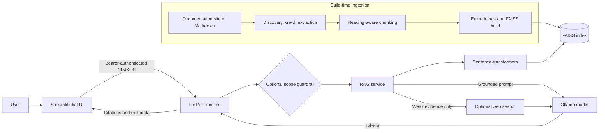
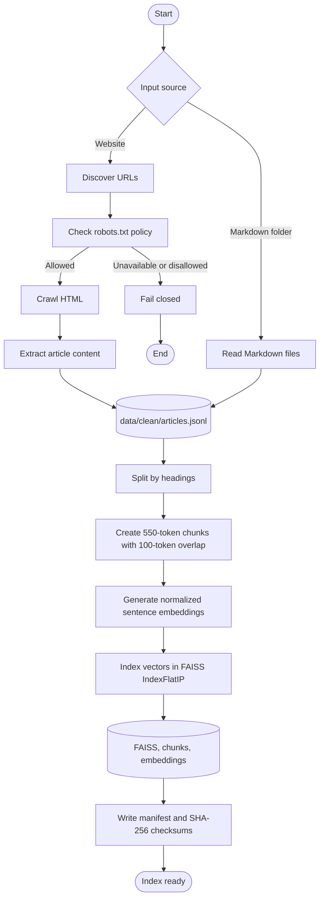
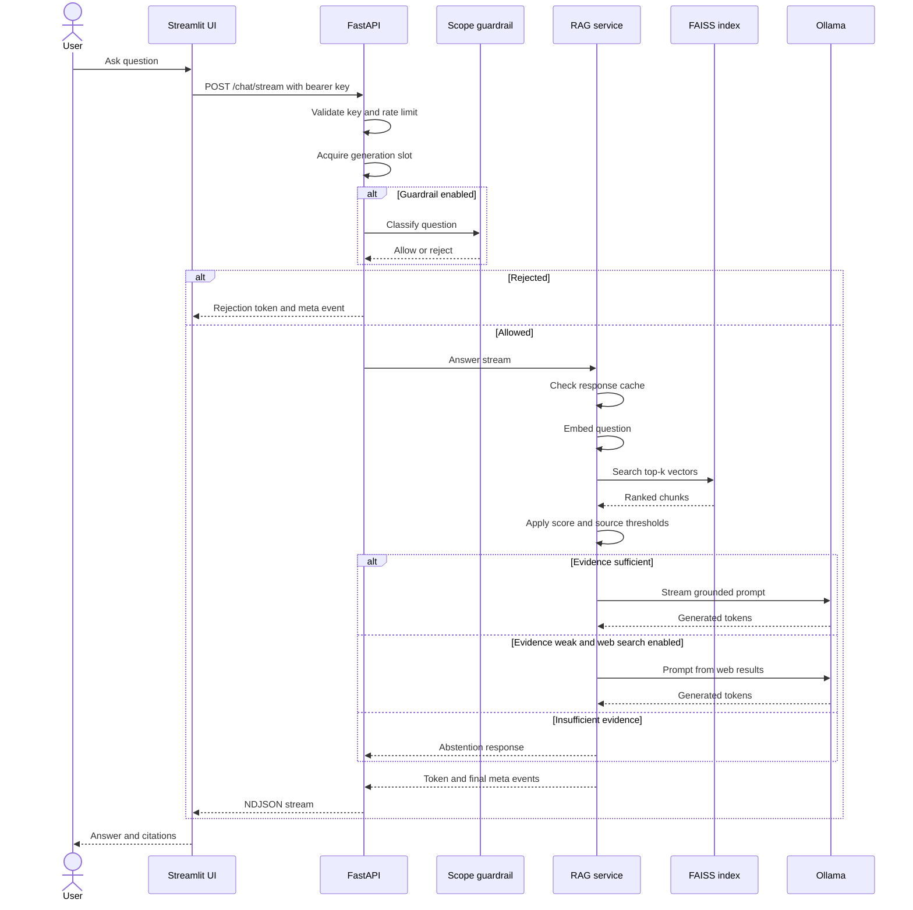
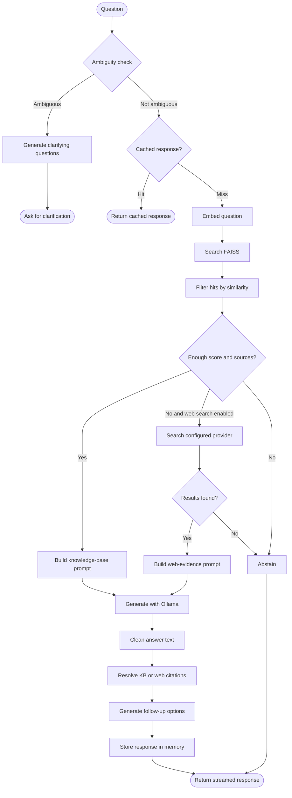
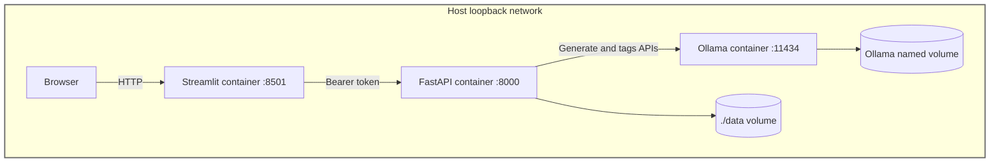
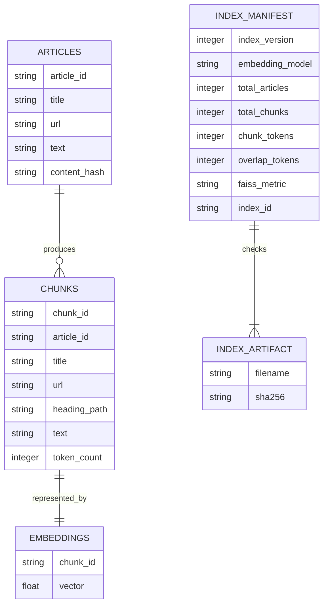

# System Diagrams

This document describes the KnowledgeBase Assistant with diagrams for architecture, ingestion, retrieval, deployment, and request handling.

## Component architecture



## Ingestion flow



## Chat request sequence



## RAG activity



## Deployment



Ports are bound to `127.0.0.1` by default. Public exposure requires TLS, authentication, authorization, durable limits, and deployment-specific monitoring.

## Data model



## Service state

```mermaid
stateDiagram-v2
    [*] --> Starting
    Starting --> NotReady: index or API key missing
    Starting --> Ready: index and Ollama model available
    NotReady --> Starting: configuration fixed and service restarted
    Ready --> Serving
    Serving --> CapacityBusy: generation slots exhausted
    CapacityBusy --> Serving: slot released
    Serving --> RatedLimited: caller exceeds per-minute limit
    RatedLimited --> Serving: next minute window
    Serving --> [*]: stopped
